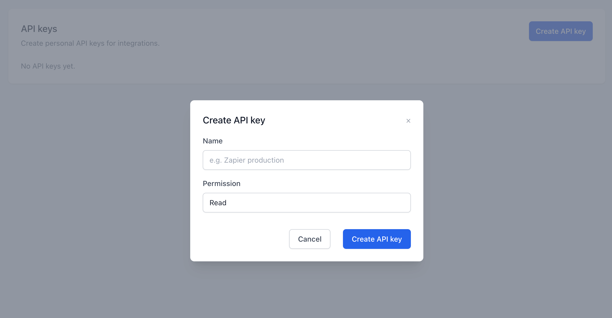
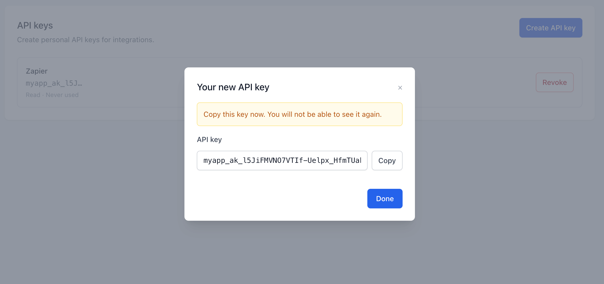
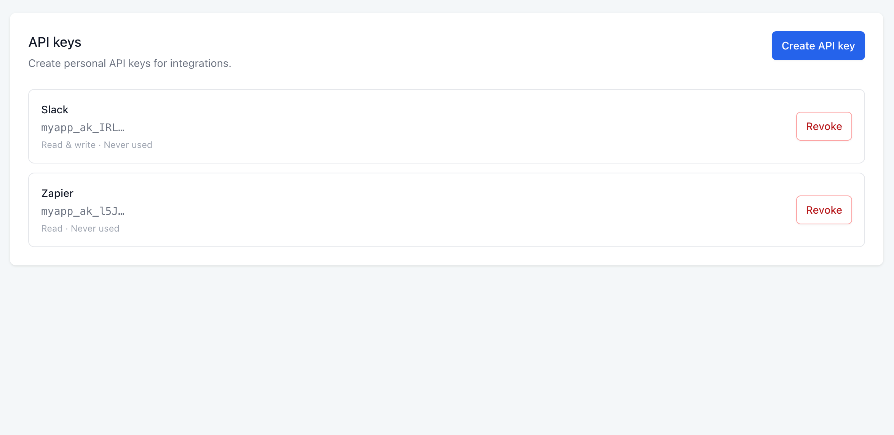

# rails_api_keys-ui

[](https://github.com/rubyroidlabs/rails_api_keys_ui/actions/workflows/ci.yml)
[](https://badge.fury.io/rb/rails_api_keys-ui)

Optional HTML/JSON UI for [rails_api_keys](https://github.com/rubyroidlabs/rails_api_keys): create (reveal once + copy), list active keys, revoke. Host apps draw routes for each owner mount.

## Screenshots

**Create** — name and permission for a new key:



**Reveal once** — copy the raw token; it is not shown again:



**List** — active keys with revoke:



## What this gem includes

- `rails_api_keys_ui` draw helper — nested or flat mounts, explicit owner resolution
- `RailsApiKeys::UI::ApiKeysController` — HTML + JSON `index` / `create` / `destroy`
- Tailwind-compatible markup + shipped scoped stylesheet (no host Tailwind required)
- Embeddable panel partial/helper
- Generators for install, controllers, views, and locales

Depends on `rails_api_keys` for the model/auth layer.

## Installation

```ruby
# Gemfile
gem "rails_api_keys"
gem "rails_api_keys-ui"
```

```bash
bundle install
bin/rails generate rails_api_keys:install   # if not already
bin/rails generate rails_api_keys_ui:install
bin/rails db:migrate
```

Views expect host Stimulus controllers named `modal` and `clipboard` (install generator can copy examples if missing). The panel inlines a scoped stylesheet by default (`config.include_stylesheet`). Then draw routes.

## Routes

```ruby
# Keys owned by current_user; nested URL is UI context only
resources :employees do
  rails_api_keys_ui owner: :current_user, controller: "api_keys"
end

# Keys owned by the Company from params[:company_id]
resources :companies do
  rails_api_keys_ui owner: :company
end

# Flat mount
rails_api_keys_ui owner: :current_user, path: "account/api_keys", as: :account_api_keys
```

Per-mount options: `owner`, `authorize`, `controller`, `path`, `name`, `as`.

## Customization

```bash
bin/rails generate rails_api_keys_ui:controllers
bin/rails generate rails_api_keys_ui:views
bin/rails generate rails_api_keys_ui:locales
```

Generated controllers subclass `RailsApiKeys::UI::ApiKeysController`. Until you generate views/locales, the gem defaults are used.

## Configuration

```ruby
# config/initializers/rails_api_keys_ui.rb
RailsApiKeys::UI.configure do |config|
  # config.parent_controller = "ApplicationController"
  # config.current_owner = ->(controller) { controller.current_user }
  # config.policy_class = "RailsApiKeys::UI::ApiKeyPolicy"
  # config.raw_token_flash_key = :rails_api_keys_raw_token
  # config.include_stylesheet = true
  # config.authorize = ->(controller, action, record) { ... }
end
```

Defaults assume Devise `current_user` and Pundit when present. Without Pundit, authorization soft-allows.

Brand colors for the shipped stylesheet: set `--rak-ui-primary-600` / `--rak-ui-primary-700` on `.rails-api-keys-ui`, or disable the stylesheet and style the Tailwind-compatible classes yourself.

## Embed in a host page

```erb
<%= rails_api_keys_ui_panel(
      api_keys: current_user.api_keys.active.order(created_at: :desc),
      create_path: employee_api_keys_path(@employee),
      destroy_path: ->(key) { employee_api_key_path(@employee, key) }
    ) %>
```

## JSON

- `GET …/api_keys.json` — active keys (no raw tokens)
- `POST …/api_keys.json` — creates key; response includes `raw_token` once
- `DELETE …/api_keys/:id.json` — revokes; `204`

## Development

```bash
bundle install
bundle exec rspec
bin/rubocop
```

See [CHANGELOG.md](./CHANGELOG.md). Agent notes: [`AGENTS.md`](./AGENTS.md).

## Contributing

Bug reports and pull requests are welcome. See [CONTRIBUTING.md](./CONTRIBUTING.md) and the [Code of Conduct](./CODE_OF_CONDUCT.md).

To report a security vulnerability privately, see [SECURITY.md](./SECURITY.md).

## License

This project is licensed under the [MIT License](./LICENSE).

---

<p align="center">
  <a href="https://rubyroidlabs.com">
    
  </a>
</p>

**[Rubyroid Labs](https://rubyroidlabs.com)** — full-cycle software development company for businesses delivering scalable web and mobile apps, dedicated developers, and full-cycle teams in Ruby on Rails, React Native, and UX/UI. 98% on-time delivery.

- Website: [rubyroidlabs.com](https://rubyroidlabs.com)
- Email: [hi@rubyroidlabs.com](mailto:hi@rubyroidlabs.com)
- References: [Clutch](https://clutch.co/profile/rubyroid-labs)
